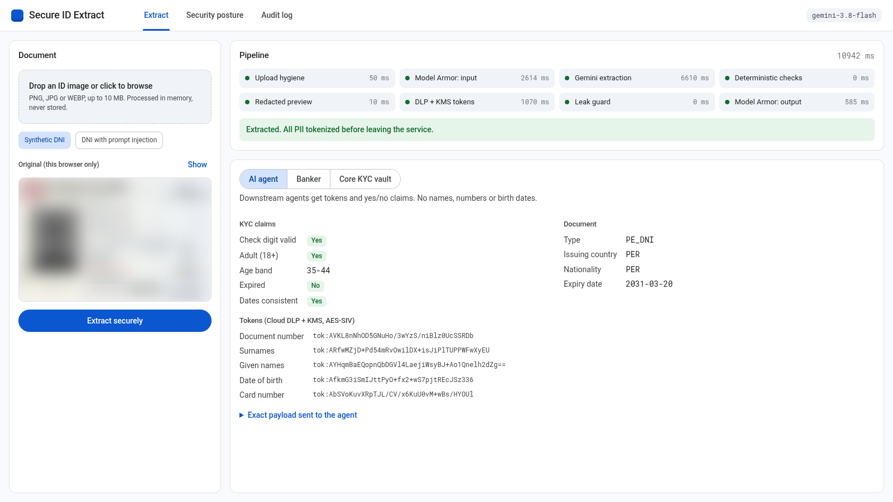
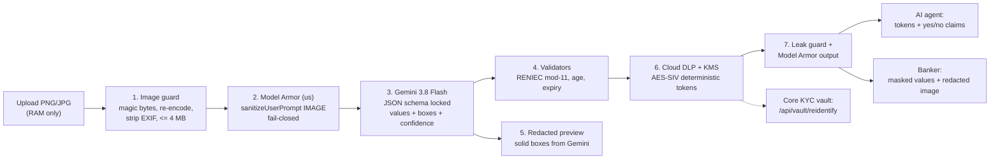
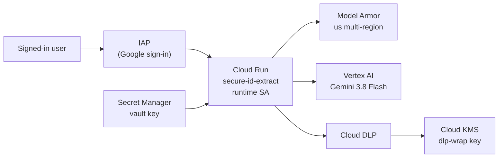
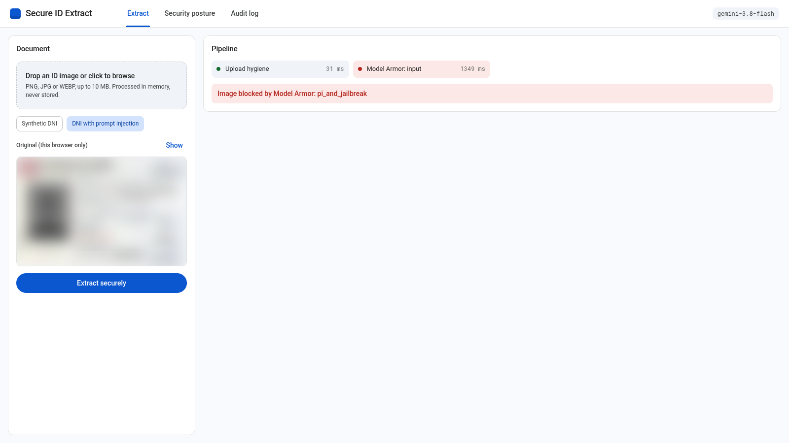
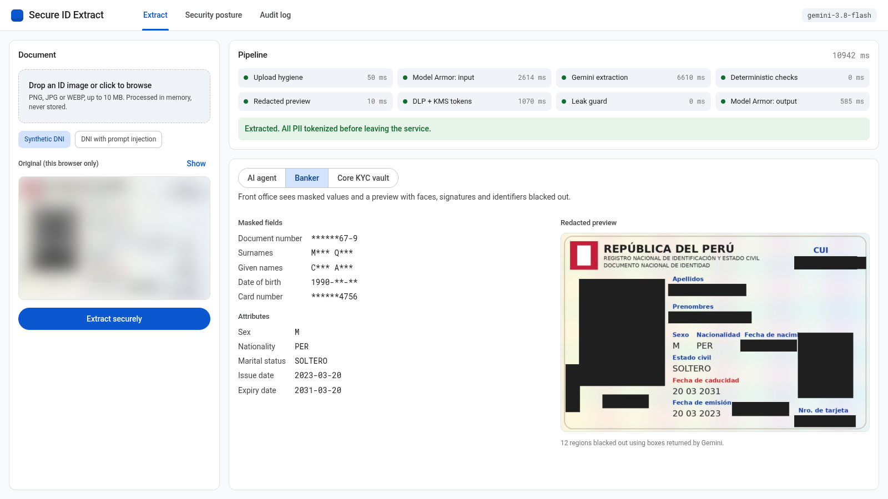

# PII Document Extract

Extract entities from identity document images (PNG/JPG, e.g. a Peruvian DNI) with a **multimodal LLM** (`gemini-3.8-flash` on Vertex AI) while keeping customer PII away from everything downstream.

Gemini reads the card in a single call. There is no Document AI, Vision API or OCR pipeline. Everything around that call is a PII control: upload hygiene, Model Armor, deterministic validation, redaction, Cloud DLP tokenization with a Cloud KMS-wrapped key, a leak guard and role-scoped outputs.



## Quick start

**Deploy to Cloud Run (authenticated, one command):**

```bash
./deploy.sh --project YOUR_PROJECT_ID
```

This sets up the APIs, the KMS key, the Model Armor templates, a least-privilege service account and a Secret Manager vault key. It then builds and deploys behind IAP (Google sign-in) and grants access to your gcloud account. It is idempotent, and it has no unauthenticated option.

**Run locally:**

```bash
./scripts/bootstrap_gcp.sh            # once per project (uses gcloud's current project or GOOGLE_CLOUD_PROJECT)
pip install -r requirements.txt
./run.sh                              # http://localhost:8796, prints a per-session vault key
```

Prerequisites: `gcloud` authenticated as a user who can enable APIs, create KMS keys, service accounts and secrets, and deploy Cloud Run (Owner or Editor + Security Admin on the project); Python 3.12+.

## Architecture



Deployed topology:



## How it works

| Stage | Module | What it does | On failure |
|---|---|---|---|
| Image guard | `app/image_guard.py` | Checks magic bytes, decodes with a pixel cap, applies EXIF rotation, rebuilds the image from pixels (drops EXIF/GPS, ICC, trailing bytes), resizes to ≤ 2400 px and ≤ 3.9 MB JPEG. | 400 |
| Model Armor input | `app/model_armor.py` | `sanitizeUserPrompt` with `byteItem: IMAGE` on a `us` template (`MODALITY_IMAGE` + `MODALITY_TEXT`). Model Armor runs OCR on the image and applies prompt-injection/jailbreak, malicious-URL, RAI and CSAM filters. No SDP on input, because an ID card always contains PII. | Block → 422. Unreachable or partial scan → 503 (fail-closed) |
| Gemini extraction | `app/extractor.py` | One multimodal call with `response_json_schema`, a system instruction that treats the image as untrusted data, `MEDIA_RESOLUTION_HIGH` and function calling disabled. Returns values, per-field confidence, `box_2d` for each value, face/signature regions and repeated personal data, plus a `contains_instructions` flag. | 502. `contains_instructions` → 422 |
| Validators | `app/validators.py` | Plain Python decides validity: RENIEC check digit (weights 3-2-7-6-5-4-3-2), age and age band, expiry, date order. | – |
| Redacted preview | `app/redactor.py` | Solid fills over the boxes Gemini returned. If any PII value or the face has no box, the preview is withheld. | Preview withheld |
| DLP + KMS tokens | `app/vault.py` | `content:deidentify` with `recordTransformations` on a one-row table and `cryptoDeterministicConfig` using a KMS-wrapped AES-256 key. The same value always gives the same token (joinable), and it can only be reversed through DLP + KMS. | 503, nothing returned |
| Leak guard | `app/pipeline.py` | Exact-match scan of the outbound payload for every cleartext form of the PII (number, names, date formats). | 500, nothing returned |
| Model Armor output | `app/model_armor.py` | `sanitizeModelResponse` on the tokenized agent payload (prompt injection, URLs, basic SDP). | 422 / 503 |

Why Model Armor is called over REST instead of through the Vertex AI integration: the native integration (floor settings / `model_armor_config`) fails open when Model Armor is unavailable and doesn't pass de-identified content back. The explicit calls make both gates fail-closed.

### Who sees what

| Consumer | Receives |
|---|---|
| AI agent / events / logs | `document_type`, `issuing_country`, `nationality`, `expiry_date`, tokens, `kyc_claims` (`document_number_checksum_valid`, `is_adult`, `age_band`, `is_expired`, `dates_consistent`), `needs_human_review` |
| Banker (front office) | Masked values (`******67-9`, `M*** Q***`, `1990-**-**`), sex, nationality, marital status, issue/expiry dates, per-field confidence, redacted image |
| Core KYC vault | Cleartext via `POST /api/vault/reidentify` with `X-Vault-Key`. The UI clears it after 30 s |

Tokenized fields: `document_number` (with check digit), `surnames`, `given_names`, `date_of_birth`, `card_number`.

### Where customer data goes

| Component | Cleartext PII | Retention |
|---|---|---|
| This service | In memory, per request | Never written to disk, logs or storage |
| Model Armor | Image, transient | Stateless; not stored unless you enable Model Armor logging |
| Gemini (Vertex AI) | Image, transient | Not used for training. Disable `cacheConfig` and use a regional endpoint for zero data retention |
| Cloud DLP + KMS | Values, transient | Stateless |
| Agents, logs, audit | None | Tokens, masked values, hashes, timings |

## Endpoints

| Method | Path | Notes |
|---|---|---|
| `POST` | `/api/extract` | multipart `file`. Optional `X-API-Key` when `API_KEY` is set. 30 req/min per IP. |
| `POST` | `/api/vault/reidentify` | `{"tokens": {...}}` with header `X-Vault-Key`. Disabled when `VAULT_API_KEY` is unset. |
| `GET` | `/api/posture` | Read-only checks: Model Armor templates, KMS key state, Vertex `cacheConfig`, endpoint residency. |
| `GET` | `/api/audit` | Last 50 events: request id, image SHA-256, outcome, stage timings. No values. |
| `GET` | `/api/samples`, `/health` | Synthetic samples, health. |

Example response (synthetic data, tokens shortened):

```json
{
  "agent_view": {
    "document_type": "PE_DNI",
    "tokens": {"document_number": "tok:AV...", "surnames": "tok:AR..."},
    "kyc_claims": {"document_number_checksum_valid": true, "is_adult": true, "age_band": "35-44",
                   "is_expired": false, "dates_consistent": true},
    "needs_human_review": false
  },
  "banker_view": {"masked": {"document_number": "******67-9", "surnames": "M*** Q***"}}
}
```

## Deployment details

`./deploy.sh` flags:

| Flag | Default | Purpose |
|---|---|---|
| `--project ID` | `$GOOGLE_CLOUD_PROJECT`, then gcloud config | Target project |
| `--region R` | `us-central1` | Cloud Run region |
| `--service NAME` | `secure-id-extract` | Service name (also names the SA and secret) |
| `--iap-user EMAIL` | current gcloud account | Grant IAP access (repeatable) |
| `--no-iap` | – | Use `run.invoker` + ID token instead of IAP |
| `--dry-run` | – | Print commands |

Resources it creates:

| Resource | Name |
|---|---|
| KMS key (90-day rotation) | `secure-id-extract/dlp-wrap` in `us-central1` |
| Model Armor templates | `secure-id-input`, `secure-id-output` in `us` |
| Runtime service account | `<service>-sa` with `aiplatform.user`, `modelarmor.user`, `modelarmor.viewer`, `dlp.user`, `serviceusage.serviceUsageConsumer`, plus `cloudkms.cryptoKeyDecrypter` and `cloudkms.viewer` on the one key |
| Secret | `<service>-vault-key` (random, read by the service as `VAULT_API_KEY`) |
| Cloud Run | `--no-allow-unauthenticated --iap`, max 2 instances |

After deploying, read the vault key with `gcloud secrets versions access latest --secret secure-id-extract-vault-key --project YOUR_PROJECT_ID`.

Configuration lives in `.env.local`, which `scripts/bootstrap_gcp.sh` generates and git ignores. See `.env.example`. It holds resource names and the **KMS-wrapped** data key (ciphertext only; the plaintext key exists only inside the bootstrap pipe). Optional `GEMINI_MODEL`, `GEMINI_LOCATION`, `GEMINI_THINKING_LEVEL`, `RATE_LIMIT_RPM` and `API_KEY` are forwarded to Cloud Run when set.

## Tests

```bash
python3 -m pytest -q tests/                          # offline
RUN_LIVE=1 python3 -m pytest -q tests/test_live.py   # live GCP, synthetic images only
```

- `test_units.py`: check digit, dates, claims, EXIF stripping, size bounds, redaction, Model Armor parsing, masking.
- `test_pipeline.py`: zero cleartext in the output, Model Armor fail-closed, blocking before Gemini, embedded instructions, vault failure, leak guard, low-confidence review flag.
- `test_hygiene.py`: only synthetic images and DNI numbers in the repo; `.env.local` ignored.
- `test_live.py`: synthetic DNI end to end with re-identification, deterministic tokens, injection card blocked by Model Armor.

All committed data is synthetic (CUI `41234567-9`, `MENDEZ QUISPE, CARLOS ALBERTO`). Regenerate it with `python3 scripts/make_synthetic_dni.py`.

## Prompt injection on a document



`data/samples/synthetic_pe_dni_injection.png` has printed instructions aimed at an AI. Model Armor's image OCR flags `pi_and_jailbreak` and the request stops before Gemini sees it. Gemini's `contains_instructions` flag is a second, independent check.



## Production hardening

- Zero data retention on Vertex AI: disable `cacheConfig` in the KYC project, leave request-response logging off, and request the abuse-monitoring exception through your account team.
- Data residency: use a regional or `us`/`eu` multi-region Gemini endpoint instead of `global` (`GEMINI_LOCATION`).
- Perimeter: put VPC Service Controls around Vertex AI, Model Armor, DLP and KMS, and use CMEK where supported.
- Replace the shared vault key with IAM, so that only the core system's identity holds `cloudkms.cryptoKeyDecrypter`.
- Python can't guarantee memory zeroization. Keep instances short-lived and dedicated to this workload.
- Gemini sees the full image, face included. If policy requires it, add a first pass that asks Gemini only for the face box, mask it, then extract.

## Project layout

```
app/        config, image_guard, model_armor, extractor, validators, redactor, vault, pipeline, posture, server
static/     single-page UI (vanilla JS, no innerHTML for server data)
scripts/    bootstrap_gcp.sh, make_synthetic_dni.py
data/       synthetic samples
tests/      offline, hygiene and live tests
deploy.sh   one-command authenticated Cloud Run deploy
run.sh      local server
```
